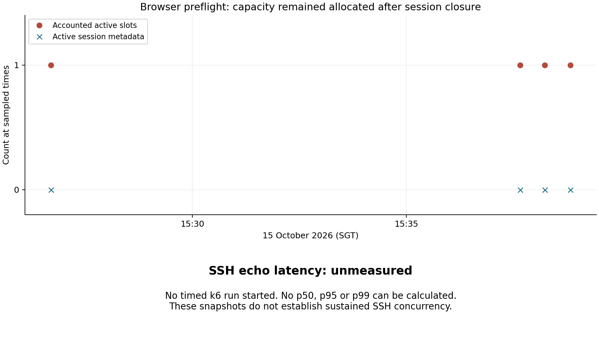
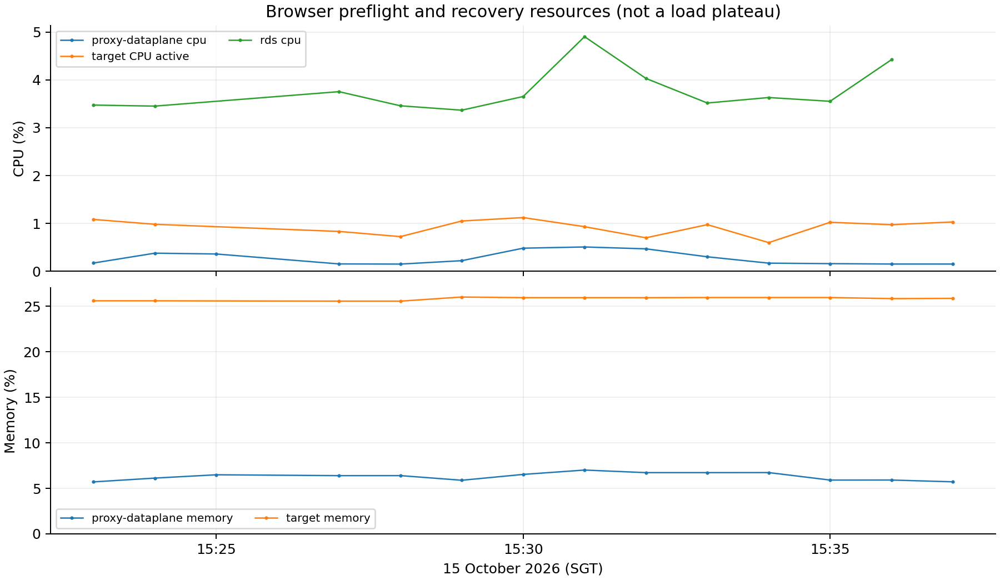

# SSH performance attempt 15 October 2026

**Stopped before timed load.** Browser preflight closed two attributed sessions, but Session Manager still accounted for one active slot while the authenticated active-session inventory was empty. The mismatch persisted beyond the five-minute recovery limit. No k6 SSH run or five-minute baseline completed. **40-session capacity, echo latency, repeatability, soak and saturation remain unmeasured.**

The authorized request was CR-609319A7, host-dev-1, 15 October 15:20–19:20 SGT, maximum 40 sessions with ten slots reserved. No infrastructure, resource limit, application code, image or database state was changed for this attempt. Both attributed sessions are now CLOSED. One stale accounted capacity slot remains unresolved; it must not be silently treated as a recovered state.

## Acceptance results

| Scenario | Required measurement | Result |
| --- | --- | --- |
| Browser authentication and echo | Normal Cognito/ALB, STS, public terminal | **Passed**: harmless marker echoed; no command executed |
| Browser detach/rejoin | Retained input and fresh echo | **Passed** |
| Browser observe | Observer input not echoed; owner remains writable | **Passed** in UI; protocol denial under load unmeasured |
| Browser resize / closure indication | Changed dimensions and observed disconnect | **Unverified**: viewport/fullscreen did not change dimensions; tabs closed before delayed disconnect indication |
| Session metadata closure | Close only attributed sessions | **Passed**: both CLOSED in authoritative Session Manager reads |
| Capacity recovery | Released capacity within recovery window | **Failed**: 0 active metadata / 1 accounted slot beyond five minutes |
| Five-minute baseline / automated smoke | Complete baseline then one lifecycle | **Not run** after failed browser cleanup |
| Concurrency discovery | 5, 10, 20, 30, 40; 60-second ramp + five-minute plateau | **Unmeasured**, zero runs |
| Repeatability | Three runs at 20 and highest passing level | **Unmeasured**, zero runs |
| Soak | Highest passing level for 20 minutes | **Unmeasured** |
| Lifecycle load | Five VUs × three minutes × three repetitions | **Unmeasured** |
| Start/close stress | Five VUs; 30/120/30 seconds; ≤2 starts/s | **Unmeasured**; separate from interactive capacity |
| Post-campaign browser check | Repeat lifecycle after load | **Not run**: no load campaign completed |
| Health and telemetry | Fixed pods/images; required samples ≤180 seconds old | **Passed at recorded preflight/recovery checks**: 12 ready workloads, no restart/revision change, 13 required metric series fresh |

SSH latency sample count is **zero**. p50/p95/p99, start latency, connection readiness, sustained concurrency, timeout/error rates and load-generator utilization are unavailable, not zero-valued performance results. Resources below describe browser preflight only.

## Resources and recovery

| Resource | Peak CPU | Peak memory | Denominator |
| --- | ---: | ---: | --- |
| Proxy Dataplane | 0.510% | 7.007% | 500m CPU / 128 MiB limits |
| Proxy Control Plane | 0.391% | 5.194% | 250m CPU / 128 MiB limits |
| Session Manager | 0.647% | 6.033% | 250m CPU / 128 MiB limits |
| Audit Service | 0.461% | 5.493% | 250m CPU / 128 MiB limits |
| STS | 0.140% | 5.499% | 250m CPU / 128 MiB limits |
| host-dev-1 | 1.124% | 26.000% | Host CPU active / host memory |
| RDS | 4.902% | Not collected | DB instance CPU |

The export retains 14 unique one-minute samples per container series, 13 per target series and 12 for RDS. Gaps and timestamps remain visible in the source exports; they are not filled with zeros. These short observations do not establish headroom under concurrent SSH load. No k6 process ran, so generator utilization is not applicable.

## Observed failure and source analysis

The first browser session, `sess-b3fc6c5b1b7919170420097322aa11fc`, was created at 07:23:47 UTC and closed at 07:25:05. Its popup was not available to the browser-control tool. The controlled terminal session, `sess-c6386e728d9c128b39ff5a588d67825d`, was created at 07:29:08 and closed at 07:32:48. The latter used explicitly approved direct navigation to the existing terminal page, with normal authenticated APIs and STS capabilities. No browser or service authentication bypass was used.

At 07:37:39, 07:38:13 and 07:38:50 UTC, active metadata was zero but accounted capacity was one. The final authoritative check at 07:42:47 confirmed both sessions CLOSED, with the same pod/process identity still reporting one accounted slot. The preflight inventory had already shown the mismatch after the first closure. UI Stop therefore cannot be treated as proof of capacity recovery.

A plausible source-level cause is the interaction between [Postgres pod registration](https://github.com/NUS-MTech-Capstone/session-manager/blob/9948d1e1ddeda365b6da140d6928f2143c86ff2a/internal/store/postgres.go) and idempotent close. Registration retains `GREATEST(stored, heartbeat)` for the same instance. Close decrements only when transitioning an ACTIVE session. A heartbeat sampled before runtime closure can restore the count after the first close; subsequent zero-runtime heartbeats and duplicate close do not lower it. **This interleaving is inferred, not captured directly from AWS.**

The proposed [regression fixture](diagnostics/capacity_close_race_repro_test.go) compiles against deployed source. Its real-PostgreSQL run was blocked before container creation because Docker reported `no space left on device`. No unrelated Docker data was removed. Reproduce by copying the fixture into `internal/store` at that source SHA and running it with `TEST_DATABASE_URL` pointing to a disposable database. The existing test helper clears its fixture tables: never point it at AWS or a shared database.

A diagnostic attempt to read individual sessions through the public route returned HTTP 405; those outcomes remain in `browser-pre.json`. The final check used the existing internal Session Manager read endpoint, recorded in `final-state.json`. These investigation requests are not a measured API-load run.

## Source and evidence identities

- Prepared harness: [`80f8244016bdfe2dcdebcf7bee4739c7c73ecd5b`](https://github.com/NUS-MTech-Capstone/k6-load-tests/tree/80f8244016bdfe2dcdebcf7bee4739c7c73ecd5b), [passing merge CI](https://github.com/NUS-MTech-Capstone/k6-load-tests/actions/runs/38698730754). This identifies the prepared harness; it did not run a timed AWS workload.
- Harness implementation: [PR 1](https://github.com/NUS-MTech-Capstone/k6-load-tests/pull/1), [capacity cleanup PR 2](https://github.com/NUS-MTech-Capstone/k6-load-tests/pull/2), [preflight accounting guard PR 3](https://github.com/NUS-MTech-Capstone/k6-load-tests/pull/3).
- Final published guard: [`6b66b9cb7f784747a12385ef441134bbe1d682cd`](https://github.com/NUS-MTech-Capstone/k6-load-tests/tree/6b66b9cb7f784747a12385ef441134bbe1d682cd), [passing merge CI](https://github.com/NUS-MTech-Capstone/k6-load-tests/actions/runs/38701851132).
- Final local verification: **31 tests passed** (8 Node, 23 Python); seven k6 profiles inspected. CI uses local fixtures only. See `harness-tests.txt` and `harness-publication.json`.
- Observed GitOps revision: `c8d5f7c02b76aebb25ea1457761c283bf35dc09a`, Synced / Healthy. Documentation commits published afterwards are not the deployment revision measured here.
- `deployed-source-identities.json` binds the 12 workloads to source labels and image digests; `final-state.json` records runtime image IDs, resource limits, pod/process identities and GitOps state.
- [13 October release index](../release-2026-10-13/README.md) retains shared-workflow pins, index/platform digest relationships and prior release/rollback evidence. This attempt made no release or rollback.
- `approved-access.json`, `browser-pre-session.json`, `browser-cleanup-diagnosis.json`, `browser-recovery.jsonl`, `final-state.json` and `campaign-stopped.json` retain the attempted workflow and failed recovery. Only allowlisted metadata is exported; no cookies, credentials, capabilities, private keys or raw terminal streams are retained.
- `analyze.py` derives `ssh-results.json` and the two charts offline. Python 3.12 and matplotlib 3.10.7 were used. Raw resource exports and sample counts are retained.
- `SHA256SUMS` covers the bundle except itself. The report is delivered separately, with source/output hashes and render QA recorded in `report-artifact.json`.

## Historical results and assessment limits

The **7 October API-only evidence remains 37,856 successful requests**, from one Agentic and two Audit read runs. Planned repetitions are incomplete (1/3 and 2/3 respectively). Its 185/185 availability probes apply only to those recorded windows. Those results are preserved unchanged and do not establish SSH performance. Compact original summaries and source identities are retained in [historical-api](historical-api/).

A01, A07 and R13 remain **partial**. The configured 40-session acceptance target is not validated. No saturation point, browser-rendering latency or long-term reliability claim is supported. The intended SSH study is limited to one AWS dev configuration, one target, synthetic PTY echo and bounded durations. The cleanup defect must be resolved and a fresh healthy preflight completed before a new campaign; the access request expires at 19:20 SGT.
